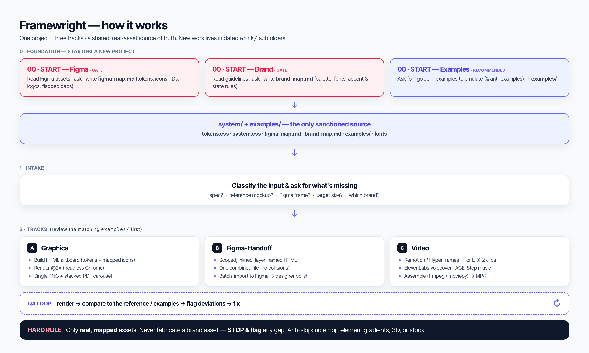

# Stillmotion

**An on-brand design and video production harness that runs inside Claude Code.** Point it at your Figma file and brand
guidelines, then ask for a social graphic, a carousel, a storyboard deck, or a finished video. It builds
from your real exported assets, checks its own output against the reference, and only then shows you.



## What you get

| Track | Output | Workflow |
|---|---|---|
| **Graphics** | Social and marketing PNGs, multi-panel carousels, stacked PDFs | [`docs/workflow-graphics.md`](docs/workflow-graphics.md) |
| **Figma handoff** | Layer-named HTML that imports into Figma as editable frames | [`docs/workflow-figma-handoff.md`](docs/workflow-figma-handoff.md) |
| **Video** | Remotion or HyperFrames MP4s, AI clips, voiceover, music, captions | [`docs/workflow-video.md`](docs/workflow-video.md) |
| **Storyboard deck** | Scene-by-scene PPTX where every element is a native, editable object | [`docs/workflow-storyboard-deck.md`](docs/workflow-storyboard-deck.md) |
| **Vertical shorts** | A finished 16:9 video rebuilt as a full-length 9:16 short | [`docs/workflow-vertical-shorts.md`](docs/workflow-vertical-shorts.md) |

Plus **101 packaged agent skills** for design, Figma, motion and video, catalogued in
[`.claude/skills/SKILLS.md`](.claude/skills/SKILLS.md).

## Quick start

```bash
git clone https://github.com/Vujavujavuja/Stillmotion-onbrand.git
cd Stillmotion-onbrand
cp .env.example .env        # add FIGMA_PAT and FIGMA_FILE_KEY
claude                      # or open the folder in the Claude Code app
```

Then, in Claude Code:

1. **"Run the Figma starter."** Claude reads your Figma file, asks a few questions, and writes
   `system/figma-map.md` (tokens, icons, logos, with node IDs).
2. **"Run the brand starter."** Claude reads your guidelines, asks about fonts, accents and hard don'ts,
   and writes `system/brand-map.md`.
3. Copy the mapped colours and font into `system/tokens.css` (Claude will do this if asked).
4. Ask for work: *"Make a 1080×1350 LinkedIn graphic explaining X, using this reference."*

Every job lands in `work/YYYY-MM-DD-name/out/`. Full setup, including the Figma token, is in
[`SETUP.md`](SETUP.md).

## Requirements

| Need | For |
|---|---|
| [Claude Code](https://claude.com/claude-code) with a Claude subscription or API key | everything |
| macOS with Google Chrome | rendering (headless Chrome at 2× and `sips`) |
| Figma account and personal access token | exporting real assets |
| Node 22+, ffmpeg | video (Remotion, HyperFrames) |
| Python 3 with `python-pptx`, `lxml`; `librsvg` | the editable storyboard deck |
| Your brand font, installed locally | on-brand type |

Optional, per job: ElevenLabs (voice, SFX, music), Higgsfield (AI image and video), RunPod (LTX-2,
ACE-Step, Qwen-edit), Manim, whisper.cpp for transcription. Each is only needed when a job uses it.

## How it works

- **It ships with no brand.** `system/tokens.css` holds a placeholder palette. The two starter gates
  write your maps, and from then on those maps are the only sanctioned source of colours, fonts, icons
  and logos. Claude will not build before both exist.
- **Real assets, never approximations.** Every element is searched for in your Figma inventory first and
  exported by node ID (`scripts/figma-export.sh <NODE_ID> svg`). Animation moves the real exported
  layers; it does not rebuild them in HTML. If an asset is missing, Claude stops and flags it.
- **Verify, review, redo, then present.** [`END.md`](END.md) is a mandatory loop: render, compare
  against the reference side by side, fix, and only open the output folder once it passes.
- **One variable, swap once.** Anything uncertain is a single CSS variable, so a correction is one edit
  and a re-render.
- **Clean git.** All job output goes in `work/`, which is gitignored. Keepers go in `examples/`.

## Repository layout

```
CLAUDE.md            operating manual Claude reads on every session
END.md               the verify → review → redo → present loop
00-START-*.md        first-run starters: Figma map, brand map, examples
docs/                craft rules, quality loop, one workflow per track, exact commands
system/              tokens.css, base CSS, and (after first run) your two maps
templates/           graphic and carousel skeletons, the storyboard-deck engine
scripts/             render, measure, combine-pdf, figma-export
examples/            your golden references and anti-examples (empty to start)
work/                job output, gitignored
.claude/skills/      101 packaged skills + SKILLS.md + THIRD_PARTY.md
```

## Skills included

| Area | Skills |
|---|---|
| Remotion (official) | 12 `remotion-*` skills: create, markup, render, captions, maps, multimedia |
| HyperFrames | 21 skills: `motion-graphics`, `embedded-captions`, `talking-head-recut`, `music-to-video`, `product-launch-video` and the core set |
| Motion libraries | 8 official `gsap-*`, `text-to-lottie`, `manim-composer`, `manimce-best-practices`, `animate`, `wiggle` |
| Audio | ElevenLabs `text-to-speech`, `speech-to-text`, `sound-effects`, `music`, `dubbing`, `voice-changer`, `voice-isolator`; `acestep` |
| Real footage | `video-use`, `clipify`, `add-zooms`, `find-broll`, `ffmpeg`, `moviepy`, `playwright-recording` |
| AI generation | 5 `higgsfield-*`, `ltx2`, `qwen-edit`, `runpod` |
| Figma | 10 `figma-*` skills (read, write, slides, FigJam, motion, code connect) |
| Design craft | `huashu-design`, `frontend-design`, `design-critique`, `design-system`, `design-handoff`, `accessibility-review`, `ux-copy`, `canvas-design`, `algorithmic-art` |

House rules in `CLAUDE.md` override any skill. In particular, HyperFrames is opt-in per job here, even
though its own skill describes itself as the entry point for all video.

**Not bundled:** Anthropic's `docx`, `pdf`, `pptx` and `xlsx` skills are not redistributable. Install them
from [anthropics/skills](https://github.com/anthropics/skills); the storyboard-deck track uses `pptx`.

## Making it yours

- Put a few finished pieces you like in `examples/` and log them in `examples/INDEX.md`. Golden examples
  improve consistency more than any written rule.
- When you correct Claude, ask it to save the lesson to memory, and log feedback in the job's `NOTES.md`.
  Promote anything that holds across jobs into `docs/craft-rules.md`.
- Record brand-specific look rules (diagram connectors, table anatomy, banned colours) in
  `system/brand-map.md`.

## Limits

- Rendering scripts assume macOS (Chrome path, `sips`). Linux needs small changes to `scripts/`.
- The storyboard-deck engine expects your frames as `NN-slug.html` files plus a `scenes.py`; a starter is
  in `templates/storyboard-deck/scenes.example.py`.
- Remotion requires a paid company licence for teams of four or more.
- Skills are vendored at fixed commits. Refresh them from the sources in `THIRD_PARTY.md`.

## Licence

The harness (everything outside `.claude/skills/`) is MIT, see [`LICENSE`](LICENSE). Each vendored skill
keeps its upstream licence: [`.claude/skills/THIRD_PARTY.md`](.claude/skills/THIRD_PARTY.md).
